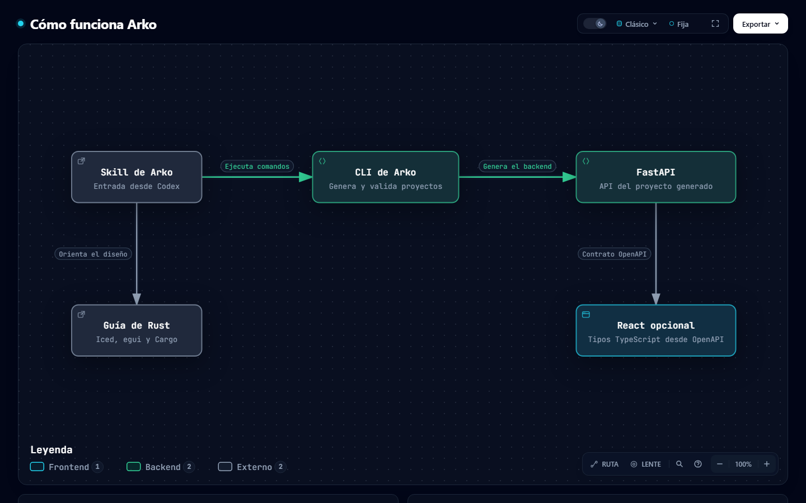

# Arquitectura de Arko

Arko separa la generación del proyecto web de la orientación para aplicaciones de escritorio. La skill de Codex dirige la solicitud a la CLI empaquetada para FastAPI o a la guía de diseño si el proyecto es nativo en Rust.

## Del plugin al proyecto

1. `init` crea la base FastAPI y copia la CLI y las plantillas que el proyecto necesita para seguir funcionando por su cuenta.
2. `add-feature` prepara los archivos de una funcionalidad. El equipo decide cómo montar su router y qué operaciones forman parte de la API pública.
3. Si añades React, Arko genera tipos TypeScript desde el OpenAPI de FastAPI. Durante el desarrollo, Vite dirige las peticiones `/api` al backend local.
4. `check` comprueba las dependencias, los límites y el contrato aprobado. Antes de aceptar un cambio de contrato, revisa las diferencias con `contract`.

El perfil web proporciona una base de trabajo. Para llevar una aplicación a producción, define identidad, datos durables y controles de despliegue según sus requisitos.

[Skill](../plugins/arko/skills/arko/SKILL.md) · [CLI](../plugins/arko/skills/arko/scripts/arko_lib/cli.py) · [Rust nativo](../plugins/arko/skills/arko/references/rust-desktop.md) · [Tutorial](tutorial.md)
